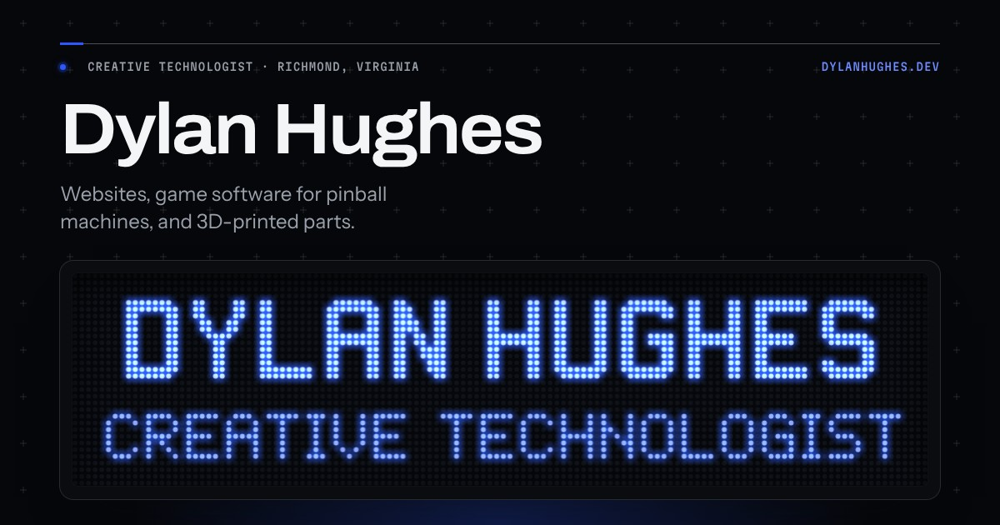

# dylanhughes.dev



**[dylanhughes.dev](https://dylanhughes.dev)**: the portfolio of Dylan Hughes, creative technologist in Richmond, Virginia.

A dark site in black, white and royal blue. Its hero is a 128 × 32 dot-matrix display with hand-drawn bitmap fonts and an attract-mode loop, including a tiny pinball table that plays itself. Opening a case study frosts the page under a wave of display pixels that rebuild into the next page.

- **No framework:** static HTML, CSS and JavaScript, with self-hosted fonts and libraries.
- **Accessible:** everything works without JavaScript, motion respects reduced-motion settings, and it's built to WCAG 2.1 AA.
- **Built with:** GSAP and Lenis, deployed on GitHub Pages.

## Design

Black and white with one accent: royal blue, the color of the display's lit dots. Three self-hosted typefaces each have one job: Archivo for headlines, Instrument Sans for reading and Martian Mono for small technical labels. Every section is laid out like a drawing's title block, the same on the home page and the case studies.

The display in the hero is the signature: an attract-mode loop of four scenes (name, what I build, a game of pinball on a little playfield with pop bumpers and flippers, Richmond and the local time) with lamp persistence and pixel-dissolve transitions. Visitors can pause it or step through scenes. Both of its bitmap fonts are drawn dot by dot in `js/dmd-glyphs.js`, the way pinball displays were lettered. The 404 page reuses it to show TILT.

## Structure

- `index.html` and `work/`: the home page and the case studies
- `css/site.css`: the whole design system, with its tokens at the top
- `js/`: navigation and scroll motion (`site.js`), the page transition (`pixels.js`), and the display and its fonts (`dmd.js`, `dmd-glyphs.js`)
- `assets/` and `fonts/`: images, films, the résumé PDF and the self-hosted fonts
- `tools/`: the résumé's source and the script that prints it

## Motion and accessibility

All content and navigation work without JavaScript. Motion runs only when the visitor has not asked for reduced motion; otherwise the display shows still frames, smooth scrolling is off and nothing animates. The display pauses when it's off screen or in a background tab.

## Local preview

Pages use root-relative paths, so serve the repository root:

```bash
python3 -m http.server 8765 --bind 127.0.0.1
```

## Deployment

GitHub Pages serves the root of `main` at `https://dylanhughes.dev/`. The `CNAME` file holds the custom domain. Pushing to `main` triggers the Pages build.

© Dylan Hughes. All rights reserved.
